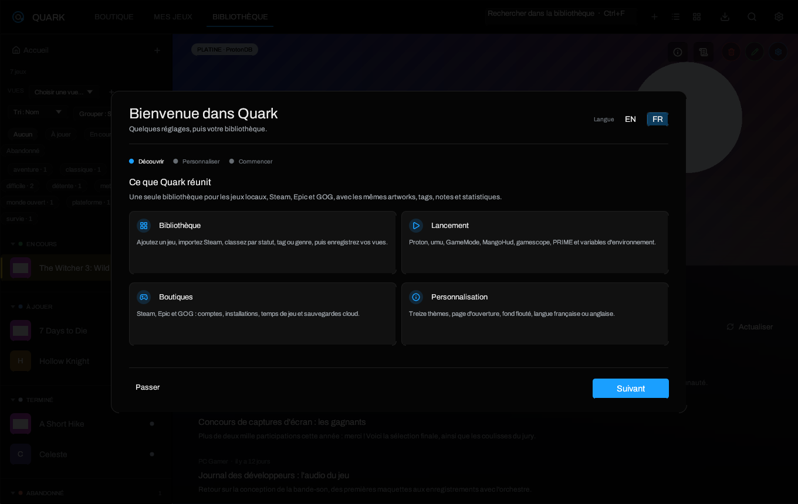
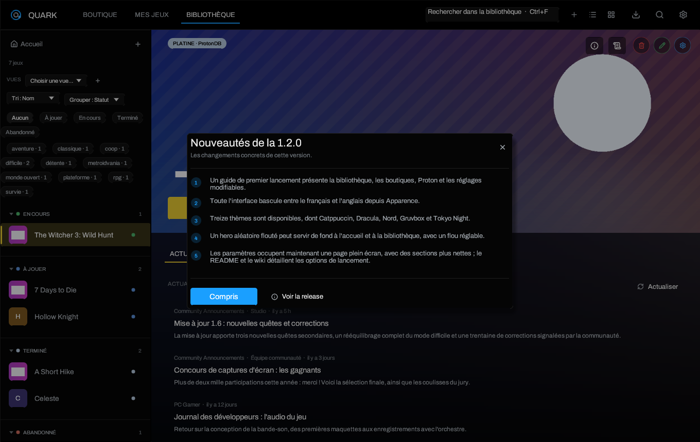

# Premier démarrage

> [Accueil](Home) · [Installation](Installation) · **Premier démarrage** ·
> [Bibliothèque](Library-and-Views) · [Réglages](Settings)

## Le parcours de bienvenue

Une configuration neuve ouvre un guide en trois étapes. Il n'est pas bloquant :
**Passer** le ferme immédiatement.

1. **Découvrir** — ce que Quark réunit : bibliothèque locale et boutiques,
   lancement Windows, boutiques, personnalisation.
2. **Personnaliser** — langue de l'interface, page d'ouverture, thème, fond hero
   aléatoire et son flou. Les changements sont appliqués en direct.
3. **Commencer** — ajout du premier jeu, raccourcis clavier et bouton
   **Terminer**.

Le guide est marqué comme terminé dès qu'il est fermé ou terminé. Pour le
revoir : **Paramètres → À propos → Revoir le guide de démarrage**.

### Langue et page d'ouverture

- **Langue de l'interface** : français ou anglais. Ce réglage est distinct de la
  langue demandée aux API Steam, qui sert aux descriptions de boutique.
- **Page d'ouverture** : Accueil (par défaut), Bibliothèque, Boutique ou Mes
  jeux. Elle est lue au démarrage suivant, pas à chaque clic.
- Ces deux réglages restent modifiables dans **Paramètres → Apparence**.

### Le résumé de version

Après une mise à jour, Quark affiche **Nouveautés de la version** une seule fois
par version. Il résume les changements concrets en quelques phrases, sans
journal de commits. Une fois fermé, la version lue est enregistrée dans
`last_seen_version`. Pour le revoir : **Paramètres → À propos → Revoir les
nouveautés**.

## Ajouter un jeu

Le bouton **+** de la barre supérieure ouvre le formulaire d'ajout.

### Jeu local

1. Choisissez le nom : Quark peut le déduire du dossier.
2. Sélectionnez l'exécutable. Un `.exe`, `.bat` ou `.msi` est reconnu comme jeu
   Windows ; un binaire Linux est lancé nativement.
3. Vérifiez le runtime : **Automatique** convient dans la plupart des cas.
4. Ajoutez éventuellement des arguments, un préfixe, un anti-triche ou des
   options graphiques.
5. **Ajouter**. La fiche peut ensuite recevoir des artworks et des tags.

### Scanner un dossier

**Ajouter → Scanner un dossier** parcourt un répertoire et propose les jeux
détectés. Le scan ne déplace rien et n'installe rien : il crée des fiches vers
les exécutables trouvés. Vérifiez toujours l'exécutable proposé avant d'ajouter,
car un dossier peut contenir un lanceur, un installateur ou une version
serveur.

### Importer Steam

**Mes jeux** lit les bibliothèques Steam déjà installées et permet d'importer
une fiche. Steam reste la source des fichiers ; Quark ne copie pas le jeu. Les
jeux Steam qui ont un manifeste mais ne sont pas installés apparaissent comme
non installés.

### Ajouter depuis Epic ou GOG

1. Installez Legendary et/ou gogdl depuis **Paramètres → Boutiques & outils**.
2. Connectez le compte avec le code fourni par la page du navigateur.
3. Ouvrez **Mes jeux**, choisissez la boutique, puis installez ou ouvrez le jeu.

Les identifiants sont écrits par Legendary/gogdl dans leurs propres fichiers,
jamais envoyés à un serveur Quark.

## Choisir le bon mode de lancement

| Cas | Réglage |
| --- | --- |
| Jeu Windows, Proton installé par Steam | **Automatique** ou un runtime Proton précis |
| Jeu Windows sans Steam | Proton détecté, ou umu-launcher |
| Jeu Linux natif | **Natif** (aucun Proton) |
| Jeu ancien ou vidéo qui refuse DXVK | Essayer Proton, puis une variable de compatibilité |
| Jeu avec anti-triche | Choisir le runtime anti-triche correspondant dans la fiche |

Le mode automatique regarde l'extension de l'exécutable : un `.exe` part en
Proton, un binaire Linux reste natif. Pour forcer un choix, ouvrez la fiche du
jeu puis **Paramètres du jeu**.

## Premier lancement utile

1. Ouvre **Paramètres → Nouveaux jeux** et choisis le Proton par défaut ainsi
   que le dossier d'installation proposé pour Epic/GOG.
2. Ouvre **Paramètres → En jeu** pour vérifier les raccourcis de l'overlay et
   des captures.
3. Installe Ludusavi depuis **Paramètres → Boutiques & outils** si vous voulez
   des instantanés de sauvegarde locaux.
4. Ajoute au moins un jeu, puis lance-le. La première création d'un préfixe
   Proton peut prendre plusieurs dizaines de secondes ; c'est normal.
5. Si le jeu démarre mais affiche un écran noir, consultez
   [Proton, Wine et options](Proton-Wine-and-Launch-Options) avant de supprimer
   le préfixe.

## Où sont mes réglages ?

Toutes les pages sont décrites dans [Réglages](Settings). Les plus utiles au
début :

- **Apparence** : langue, thème, page d'ouverture, fond aléatoire, accueil.
- **Nouveaux jeux** : valeurs recopiées dans chaque nouveau jeu. Ce ne sont pas
  des réglages globaux : modifier un défaut ne change pas les jeux existants.
- **Boutiques & outils** : comptes, synchronisation, Legendary, gogdl, Ludusavi.
- **En jeu** : overlay, captures, succès, sauvegardes cloud.

## Et ensuite ?

- [Bibliothèque et vues](Library-and-Views) pour organiser les jeux.
- [Boutiques et sauvegardes](Stores-and-Saves) pour Epic, GOG et le cloud.
- [Thèmes et apparence](Themes-and-Appearance) pour les 13 thèmes et le fond
  hero.

---

[Accueil](Home) · [Installation](Installation) · [Bibliothèque](Library-and-Views) · [Réglages](Settings)
