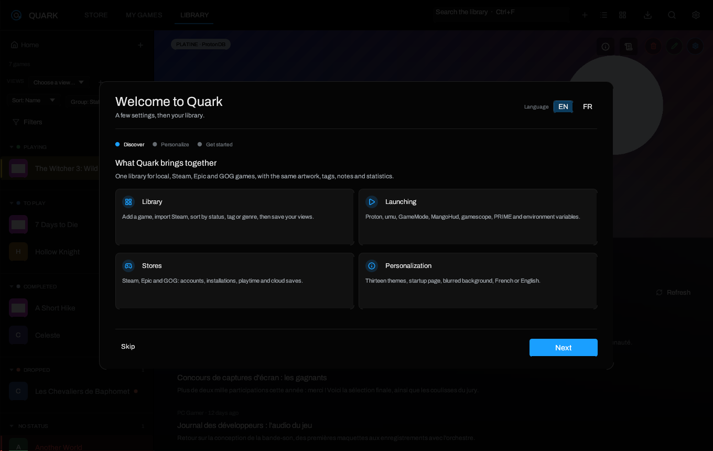
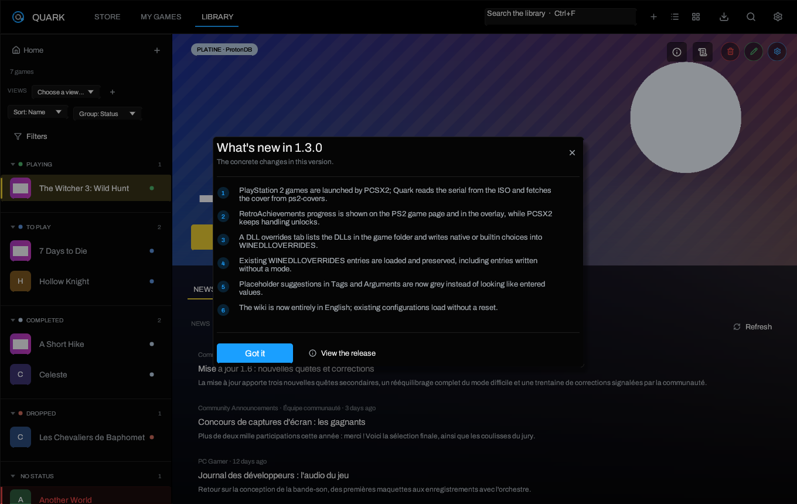

# Getting started

> [Home](Home) · [Installation](Installation) · **Getting started** ·
> [Library](Library-and-Views) · [Settings](Settings)

## The welcome guide

A new configuration opens a three-step guide. It is not blocking: **Skip**
closes it immediately.

1. **Discover** — what Quark brings together: local games and stores, Windows
   launch options, stores and customization.
2. **Customize** — interface language, startup page, theme, random hero
   background and its blur. Changes apply live.
3. **Start** — add the first game, see the keyboard shortcuts and finish with
   **Finish**.

The guide is marked as done when it is closed or completed. To see it again:
**Settings → About → Review the getting-started guide**.

### Language and startup page

- **Interface language**: French or English. This is separate from the language
  requested from Steam APIs, which controls store descriptions.
- **Startup page**: Home (default), Library, Store or My games. It is read on the
  next launch, not on every click.
- Both settings remain available in **Settings → Appearance**.

### The release summary

After an update, Quark shows **What's new** once per version. It summarizes the
concrete changes in a few sentences, not a commit log. Once closed, the version
is stored in `last_seen_version`. To see it again: **Settings → About → Review
what's new**.

## Add a game

The **+** button in the top bar opens the add form.

### Local game

1. Choose a name: Quark can infer it from the folder.
2. Select the executable. A `.exe`, `.bat` or `.msi` is treated as a Windows
   game; a Linux binary runs natively.
3. Check the runtime: **Automatic** is right in most cases.
4. Optionally add arguments, a prefix, anti-cheat or graphics options.
5. **Add**. The game page can then receive artwork and tags.

### PlayStation 2 game

Use **+ → PlayStation 2 game (ISO)…** and pick an image. Quark reads the serial
number from `SYSTEM.CNF` for uncompressed `.iso` files, fetches the community
cover and launches PCSX2. `.chd`, `.cso`, `.bin/.cue` and `.gz` images are
accepted with a serial entered by hand in the game's **PlayStation 2** tab.

See [PlayStation 2 and RetroAchievements](PlayStation-2-and-RetroAchievements).

### Scan a folder

**Add → Choose a folder…** walks a directory and proposes detected games. The
scan moves and installs nothing: it creates entries pointing at the executables
it found. Always check the proposed executable before adding, because a folder
can contain a launcher, an installer or a server build.

### Import Steam

**My games** reads already installed Steam libraries and lets you import an
entry. Steam remains the source of the files; Quark does not copy the game.
Steam games with a manifest but no installed files appear as not installed.

### Add from Epic or GOG

1. Install Legendary and/or gogdl from **Settings → Stores & tools**.
2. Connect the account with the code shown by the browser page.
3. Open **My games**, choose the store, then install or open the game.

Credentials are written by Legendary/gogdl in their own files and never sent to
a Quark server.

## Choose the right launch mode

| Case | Setting |
| --- | --- |
| Windows game with Proton installed by Steam | **Automatic** or a specific Proton runtime |
| Windows game without Steam | A detected Proton runtime, or umu-launcher |
| Native Linux game | **Native** (no Proton) |
| Old game or video that rejects DXVK | Try Proton, then a compatibility variable |
| Game with anti-cheat | Choose the matching anti-cheat runtime on the game page |
| PlayStation 2 disc image | PCSX2, selected automatically for the game |

Automatic mode looks at the executable extension: an `.exe` goes through
Proton, a Linux binary stays native, and a disc image goes through PCSX2. To
force a choice, open the game page and then **Game settings**.

## A useful first launch

1. Open **Settings → New games** and choose the default Proton runtime and the
   installation folder proposed for Epic/GOG.
2. Open **Settings → In game** to check the overlay and screenshot shortcuts.
3. Install Ludusavi from **Settings → Stores & tools** if you want local save
   snapshots.
4. Add at least one game and launch it. The first Proton prefix can take several
   tens of seconds to be created; this is normal.
5. If the game starts but shows a black screen, read
   [Proton, Wine and options](Proton-Wine-and-Launch-Options) before deleting the
   prefix.

## Where are my settings?

Every page is described in [Settings](Settings). The most useful ones at the
beginning:

- **Appearance**: language, theme, startup page, random hero, home page.
- **New games**: values copied into each new game. These are not global
  settings: changing a default does not affect existing games.
- **Stores & tools**: accounts, synchronization, Legendary, gogdl, Ludusavi,
  PCSX2 and RetroAchievements.
- **In game**: overlay, screenshots, achievements, cloud saves.

## What next?

- [Library and views](Library-and-Views) to organize games.
- [Stores and saves](Stores-and-Saves) for Epic, GOG and cloud saves.
- [PlayStation 2 and RetroAchievements](PlayStation-2-and-RetroAchievements) for
  PCSX2, covers and achievement progress.
- [Themes and appearance](Themes-and-Appearance) for the thirteen themes and the
  hero background.

---

[Home](Home) · [Installation](Installation) · [Library](Library-and-Views) · [Settings](Settings)
