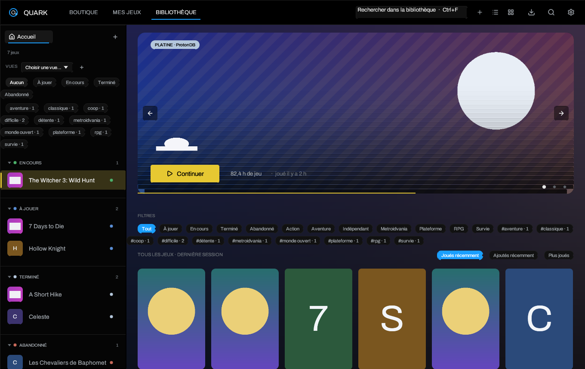

# Quark Wiki

Quark est un launcher de jeux pour Linux, écrit en Rust avec egui. Il réunit les
jeux locaux, Steam, Epic Games et GOG dans une seule bibliothèque, lance les jeux
Windows avec Proton ou umu-launcher, et ajoute un overlay en jeu, des captures,
des succès et des sauvegardes locales vérifiées.

Cette documentation décrit **Quark 1.2.0**. Elle est aussi disponible dans le
dépôt, sous [`wiki/`](https://github.com/Matheotaku4/Quark-Launcher/tree/main/wiki).

## Par où commencer

| Besoin | Page |
| --- | --- |
| Installer ou mettre à jour Quark | [Installation](Installation) |
| Premier lancement, bibliothèque, réglages de base | [Premier démarrage](Getting-Started) |
| Comprendre la liste, la grille, les vues et les filtres | [Bibliothèque et vues](Library-and-Views) |
| Steam, Epic, GOG, comptes et sauvegardes cloud | [Boutiques et sauvegardes](Stores-and-Saves) |
| Proton, umu, Wine, variables et options de lancement | [Proton, Wine et options](Proton-Wine-and-Launch-Options) |
| Thèmes, langue, fond aléatoire, page d'ouverture | [Thèmes et apparence](Themes-and-Appearance) |
| Overlay, captures et succès | [Overlay et succès](Overlay-and-Achievements) |
| Toutes les pages de réglages | [Réglages](Settings) |
| Un jeu ne démarre pas, un texte est absent, un souci de sauvegarde | [Dépannage](Troubleshooting) |

## Ce que fait Quark

- **Une bibliothèque unique** : les jeux locaux et les jeux de boutique
  partagent couverture, héros, logo, notes, tags, temps de jeu et statistiques.
  Un même jeu peut avoir plusieurs installations sans apparaître deux fois.
- **Steam, Epic Games et GOG** : Steam est lu depuis les dossiers locaux.
  Legendary gère Epic, gogdl gère GOG. Les mots de passe ne passent jamais par
  Quark ; seuls les jetons écrits par ces outils restent sur la machine.
- **Proton sans ligne de commande** : runtime par jeu, préfixe, GameMode,
  MangoHud, gamescope, PRIME, wrapper libre, variables d'environnement,
  runtimes anti-triche et umu-launcher.
- **Un vrai overlay** : `Maj+Retour arrière` ouvre un panneau au-dessus du jeu,
  `F12` prend une capture. Les succès Epic et GOG sont normalisés dans le même
  affichage.
- **Sauvegardes** : synchronisation cloud Epic/GOG et instantanés Ludusavi
  vérifiés avant et après une session.
- **Une interface réglable** : 13 thèmes sombres, français ou anglais, liste ou
  grille, accueil personnalisable, fond hero aléatoire flouté, palette `Ctrl+K`.
- **Un launcher, pas une boutique** : Quark n'achète rien et ne télécharge aucun
  jeu depuis un site tiers. Les résultats de recherche ouvrent le navigateur.

## Raccourcis essentiels

| Raccourci | Action |
| --- | --- |
| `Ctrl+K` | Palette de commandes : pages, actions et jeux |
| `Ctrl+F` ou `/` | Chercher dans la bibliothèque |
| `Échap` | Fermer une recherche, un panneau ou l'overlay |
| `Entrée` | Lancer le jeu sélectionné |
| `Flèches` | Naviguer dans la bibliothèque |
| `Maj+Retour arrière` | Ouvrir ou fermer l'overlay en jeu |
| `F12` | Capture d'écran du jeu en cours |
| `Ctrl+Q` | Quitter réellement Quark |

## État de cette documentation

- Les captures proviennent du mode `--demo` : les jaquettes sont des
  remplacements volontairement neutres, pas les artworks réels des jeux.
- Les comptes Epic/GOG et un serveur graphique réel ne sont pas disponibles dans
  l'environnement de construction. Les chemins de code, migrations et erreurs
  sont testés, mais un essai manuel avec un vrai compte reste recommandé.
- Le wiki GitHub est un dépôt séparé. Le publier demande une authentification
  GitHub avec accès au wiki ; le contenu source est versionné ici pour être
  synchronisé dès que cet accès est disponible.

## Licence

Quark est distribué sous licence MIT. La police Archivo est sous SIL Open Font
License et les icônes Lucide sous ISC. Voir
[`assets/fonts/`](https://github.com/Matheotaku4/Quark-Launcher/tree/main/assets/fonts)
et les notes de version pour les fichiers exacts.

---

[Installation](Installation) · [Premier démarrage](Getting-Started) ·
[Bibliothèque](Library-and-Views) · [Boutiques](Stores-and-Saves) ·
[Proton et Wine](Proton-Wine-and-Launch-Options) ·
[Thèmes](Themes-and-Appearance) · [Overlay](Overlay-and-Achievements) ·
[Réglages](Settings) · [Dépannage](Troubleshooting)
