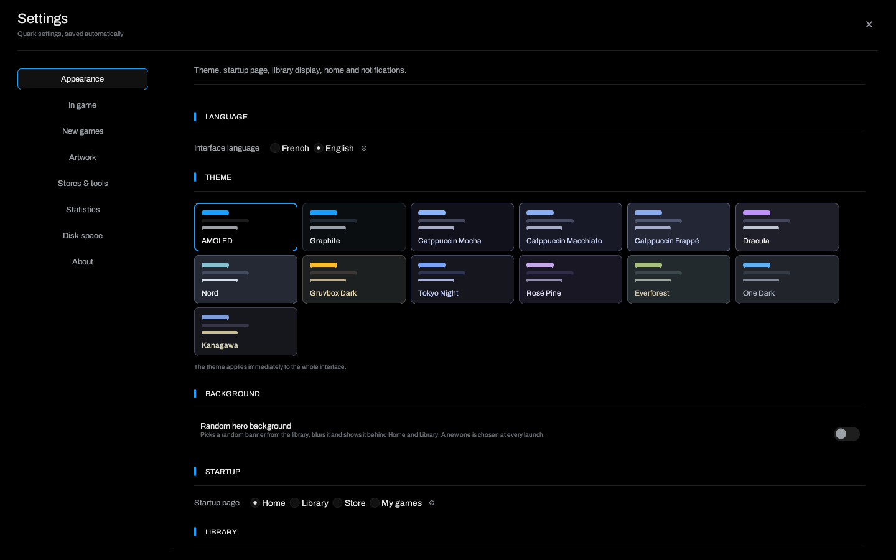

# Installation and updates

> [Home](Home) · **Installation** · [Getting started](Getting-Started) ·
> [Troubleshooting](Troubleshooting)



## Requirements

- Linux x86_64 with X11 or Wayland.
- OpenGL and the usual graphics libraries of your distribution.
- `python3` for Legendary and gogdl: both are Python applications packaged as
  zipapps.
- Optional, depending on the features you use: `gamescope`, `gamemoderun`
  (GameMode), `mangohud`, `umu-launcher`, `ludusavi` and PCSX2.
- To build: stable Rust, `pkg-config`, the X11/Wayland headers and OpenGL.

Quark needs no Quark account and sends no telemetry.

## Release archive

1. Download `quark-1.3.1-linux-x86_64.tar.gz` and its `.sha256` file from the
   [latest release](https://github.com/Matheotaku4/Quark-Launcher/releases/latest).
2. Verify the archive **before** extracting it:

   ```bash
   sha256sum -c quark-1.3.1-linux-x86_64.tar.gz.sha256
   tar -xzf quark-1.3.1-linux-x86_64.tar.gz
   ./quark/quark
   ```

3. The archive contains `quark/quark`, `quark/README.md`, `quark/quark.desktop`
   and `quark/quark.png`.

### Install in the applications menu

```bash
install -Dm755 quark/quark ~/.local/bin/quark
install -Dm644 quark/quark.desktop ~/.local/share/applications/quark.desktop
install -Dm644 quark/quark.png ~/.local/share/icons/hicolor/512x512/apps/quark.png
update-desktop-database ~/.local/share/applications 2>/dev/null || true
```

`~/.local/bin` must be in your `PATH`, because the desktop entry uses
`Exec=quark`. Otherwise replace that line with the absolute path to the binary
in `quark.desktop`.

## Update from 1.1.4 or later

Quark 1.3.1 keeps the `config.json` format used by 1.1.4 and adds fields with
default values. Updating does not require resetting the library and does not
force the welcome guide on existing installations.

### Automatic update

1. Start Quark 1.1.4 or later.
2. Open **Settings → About**.
3. Click **Check for updates**, or leave **Install updates on startup** enabled.
4. Quark downloads the archive, verifies its SHA-256, replaces the binary and
   restarts.

Replacement is refused cleanly when the binary is a development build, when the
folder is read-only, or when a game launched by Quark is still running. The old
executable is kept until the next successful start.

### Manual update

If automatic updates are disabled or fail:

1. Quit Quark, then download the 1.3.1 archive and its checksum.
2. Verify the checksum, then replace only the binary:

   ```bash
   sha256sum -c quark-1.3.1-linux-x86_64.tar.gz.sha256
   tar -xzf quark-1.3.1-linux-x86_64.tar.gz
   install -Dm755 quark/quark ~/.local/bin/quark
   ```

3. Start Quark again. The configuration is migrated on first launch.

Your games, prefixes, saves, artwork, Legendary/gogdl accounts and statistics
stay in the same folders. The welcome guide is skipped for an existing library;
the **What's new in 1.3.1** summary appears once.

> Do not delete `~/.config/quark/config.json` to "repair" an update. If the file
> cannot be read, Quark keeps a `config.json.corrompu-<timestamp>` copy and
> switches to read-only instead of overwriting the library.

## Build from source

```bash
git clone https://github.com/Matheotaku4/Quark-Launcher.git
cd Quark-Launcher
cargo build --release --locked
./target/release/quark
```

On Debian/Ubuntu, the dependencies used by CI are:

```bash
sudo apt-get install build-essential pkg-config libx11-dev libxkbcommon-dev \
  libwayland-dev libgl1-mesa-dev
```

Before publishing:

```bash
cargo fmt --check
cargo test --offline
cargo build --release --locked --offline
```

## Uninstall

Quark creates no system service. To remove the program:

```bash
rm -f ~/.local/bin/quark
rm -f ~/.local/share/applications/quark.desktop
rm -f ~/.local/share/icons/hicolor/512x512/apps/quark.png
```

Game data stays in `~/.config/quark/`, `~/.local/share/quark/` and the
Steam/Epic/GOG folders. Remove those separately if you also want to erase the
library, prefixes and saves. Never delete a Proton prefix unless you are sure it
does not contain a game's saves.

## Updates and integrity

- Every published archive comes with a `.sha256` file.
- Managed tools (Legendary, gogdl, Ludusavi) are also verified against their
  published checksum before running.
- An update that does not match the expected tag is refused.
- The release notes for the current release are in
  [`docs/release-notes.md`](https://github.com/Matheotaku4/Quark-Launcher/blob/main/docs/release-notes.md).

## If something goes wrong

Read [Troubleshooting](Troubleshooting) for launch errors, prefixes, Wayland and
blocked updates.

---

[Home](Home) · [Getting started](Getting-Started) · [Troubleshooting](Troubleshooting)
