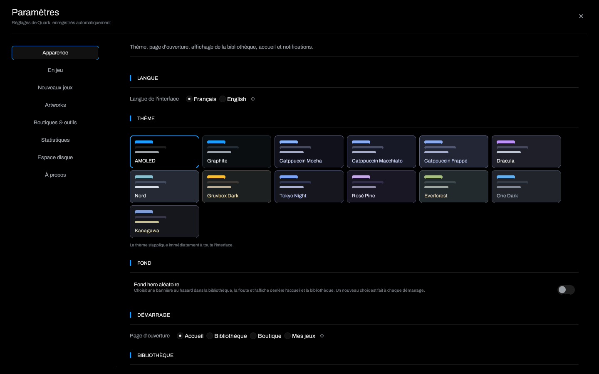

# Installation et mise à jour

> [Accueil](Home) · **Installation** · [Premier démarrage](Getting-Started) ·
> [Dépannage](Troubleshooting)



## Prérequis

- Linux x86_64 avec X11 ou Wayland.
- OpenGL et les bibliothèques graphiques habituelles de la distribution.
- `python3` pour Legendary et gogdl : ce sont des applications Python
  empaquetées en zipapp.
- Facultatif selon les options utilisées : `gamescope`, `gamemoderun`
  (GameMode), `mangohud`, `umu-launcher` et `ludusavi`.
- Pour compiler : Rust stable, `pkg-config`, les en-têtes X11/Wayland et
  OpenGL.

Quark ne nécessite aucun compte Quark et n'envoie aucune télémétrie.

## Archive de release

1. Téléchargez `quark-1.2.1-linux-x86_64.tar.gz` et son fichier `.sha256`
   depuis la [dernière release](https://github.com/Matheotaku4/Quark-Launcher/releases/latest).
2. Vérifiez l'archive **avant** de l'extraire :

   ```bash
   sha256sum -c quark-1.2.1-linux-x86_64.tar.gz.sha256
   tar -xzf quark-1.2.1-linux-x86_64.tar.gz
   ./quark/quark
   ```

3. L'archive contient `quark/quark`, `quark/README.md`, `quark/quark.desktop`
   et `quark/quark.png`.

### Installer dans le menu des applications

```bash
install -Dm755 quark/quark ~/.local/bin/quark
install -Dm644 quark/quark.desktop ~/.local/share/applications/quark.desktop
install -Dm644 quark/quark.png ~/.local/share/icons/hicolor/512x512/apps/quark.png
update-desktop-database ~/.local/share/applications 2>/dev/null || true
```

`~/.local/bin` doit être dans votre `PATH`, car l'entrée de bureau utilise
`Exec=quark`. Sinon, remplacez cette ligne par le chemin absolu du binaire dans
`quark.desktop`.

## Mettre à jour depuis la 1.1.4

La 1.2.1 conserve le format de `config.json` de la 1.1.4 et ajoute des champs
avec des valeurs par défaut. La mise à jour ne demande pas de réinitialiser la
bibliothèque et n'impose pas le parcours de bienvenue aux installations déjà
existantes.

### Mise à jour automatique

1. Lancez Quark 1.1.4 ou une version ultérieure.
2. Ouvrez **Paramètres → À propos**.
3. Cliquez sur **Vérifier les mises à jour**, ou laissez
   **Installer les mises à jour au démarrage** actif.
4. Quark télécharge l'archive, vérifie son SHA-256, remplace le binaire et se
   relance.

Le remplacement est refusé proprement si le binaire est un binaire de
développement, si le dossier est en lecture seule, ou si un jeu lancé par Quark
est encore en cours. L'ancien exécutable est conservé jusqu'au prochain
démarrage réussi.

### Mise à jour manuelle

Si la mise à jour automatique est désactivée ou échoue :

1. Quittez Quark, puis téléchargez l'archive 1.2.1 et sa somme.
2. Vérifiez la somme, puis remplacez uniquement le binaire :

   ```bash
   sha256sum -c quark-1.2.1-linux-x86_64.tar.gz.sha256
   tar -xzf quark-1.2.1-linux-x86_64.tar.gz
   install -Dm755 quark/quark ~/.local/bin/quark
   ```

3. Relancez Quark. La configuration est migrée à la première ouverture.

Vos jeux, préfixes, sauvegardes, artworks, comptes Legendary/gogdl et
statistiques restent dans les mêmes dossiers. Le parcours de bienvenue est
ignoré pour une bibliothèque existante ; le résumé **Nouveautés de la 1.2.1**
apparaît une fois.

> Ne supprimez pas `~/.config/quark/config.json` pour « réparer » une mise à
> jour. En cas de fichier illisible, Quark en garde une copie
> `config.json.corrompu-<horodatage>` et passe en lecture seule au lieu
> d'écraser la bibliothèque.

## Compiler depuis les sources

```bash
git clone https://github.com/Matheotaku4/Quark-Launcher.git
cd Quark-Launcher
cargo build --release --locked
./target/release/quark
```

Sous Debian/Ubuntu, les dépendances utilisées par la CI sont :

```bash
sudo apt-get install build-essential pkg-config libx11-dev libxkbcommon-dev \
  libwayland-dev libgl1-mesa-dev
```

Pour les tests et la vérification avant publication :

```bash
cargo fmt --check
cargo test --offline
cargo build --release --locked --offline
```

## Désinstaller

Quark ne crée pas de service système. Pour retirer le programme :

```bash
rm -f ~/.local/bin/quark
rm -f ~/.local/share/applications/quark.desktop
rm -f ~/.local/share/icons/hicolor/512x512/apps/quark.png
```

Les données de jeu restent dans `~/.config/quark/`, `~/.local/share/quark/` et
dans les dossiers Steam/Epic/GOG. Supprimez-les séparément si vous voulez aussi
effacer la bibliothèque, les préfixes et les sauvegardes. Ne supprimez jamais un
préfixe Proton sans être sûr qu'il ne contient pas les sauvegardes d'un jeu.

## Mises à jour et intégrité

- Chaque archive publiée est accompagnée d'un fichier `.sha256`.
- Les outils gérés (Legendary, gogdl, Ludusavi) sont aussi vérifiés par leur
  somme publiée avant exécution.
- Une mise à jour qui ne correspond pas au tag attendu est refusée.
- Les notes de version de la release courante sont dans
  [`docs/release-notes.md`](https://github.com/Matheotaku4/Quark-Launcher/blob/main/docs/release-notes.md).

## En cas de problème

Consultez [Dépannage](Troubleshooting) pour les erreurs de lancement, les
préfixes, Wayland et les mises à jour bloquées.

---

[Accueil](Home) · [Premier démarrage](Getting-Started) · [Dépannage](Troubleshooting)
