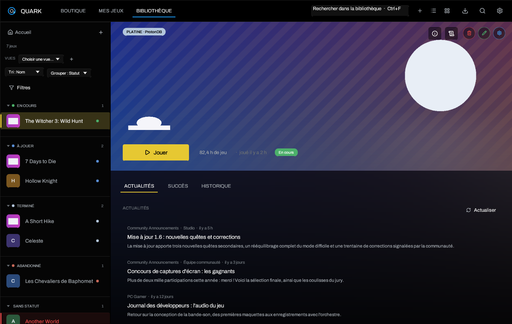

# Bibliothèque et vues

> [Accueil](Home) · [Premier démarrage](Getting-Started) · **Bibliothèque** ·
> [Boutiques](Stores-and-Saves) · [Réglages](Settings)

## Deux présentations

La bibliothèque se présente en **liste** ou en **grille**. Le choix est conservé
dans la configuration et se change avec les deux icônes de la barre supérieure
ou dans **Paramètres → Apparence → Affichage de la bibliothèque**.

- **Liste** : une ligne par jeu, avec icône carrée, nom, temps de jeu, dernier
  usage, pastille de statut et marqueur de sélection. Les groupes peuvent être
  repliés.
- **Grille** : uniquement les couvertures, pour parcourir une grande
  bibliothèque. Un clic ouvre la fiche du jeu en surimpression.

Les jeux dont l'exécutable est introuvable sont signalés en rouge. Un jeu
marqué comme en cours d'exécution garde son état visible même après un
changement de page.

## Rechercher

- `Ctrl+F` ou `/` place le curseur dans la recherche.
- `Échap` vide la recherche.
- La recherche ignore les accents et compare séparément le titre, le
  développeur, les tags et les genres. Une requête ne peut donc pas correspondre
  en dispersant ses lettres entre plusieurs champs.
- Le bouton **Filtres** ouvre un panneau unique pour le statut, le genre Steam
  et les tags personnels. Le nombre de filtres actifs apparaît sur le bouton et
  **Tout effacer** les retire d'un coup.

## Trier, filtrer, grouper

**Tri** : nom, dernière session, date d'ajout ou temps de jeu.

**Filtres** : le bouton en forme d'entonnoir, au-dessus de la liste, regroupe
le statut (`À jouer`, `En cours`, `Terminé`, `Abandonné`), le genre Steam et le
tag personnel. Les filtres se combinent, restent ouverts pendant la sélection et
le bouton indique leur nombre. **Tout effacer** remet la liste complète. La
recherche libre reste dans la barre du haut.

**Groupement** de la liste :

- par **statut** ;
- par **boutique** ;
- par **genre** ;
- par **année de sortie** ;
- ou aucun groupe, pour une liste continue.

Les en-têtes de groupe affichent un compteur et peuvent être repliés. Le
regroupement ne modifie pas l'ordre des jeux à l'intérieur d'un groupe.

## Vues enregistrées

Le menu **Vues** enregistre l'état courant : recherche, filtres, tri et
groupement. Une vue peut être appliquée ou supprimée plus tard.

Trois vues de départ sont créées une seule fois : **À jouer**, **En cours** et
**Terminés**. Si vous les supprimez, elles ne sont pas recréées au démarrage
suivant. Les vues vides, les doublons et les filtres pointant vers un tag ou un
genre supprimé sont nettoyés au chargement et à l'enregistrement. La liste est
limitée à 32 vues.

## Accueil

L'accueil affiche un carrousel des jeux récemment joués, puis la bibliothèque en
couvertures. Le carrousel peut défiler automatiquement ; le délai se règle dans
**Paramètres → Apparence → Accueil**.

Le bouton principal devient **Arrêter** quand le jeu tourne. Le temps de jeu, la
dernière session, la note ProtonDB et le badge Linux natif sont visibles sur la
bannière.

**Fond hero aléatoire** : quand l'option est active, Quark choisit une bannière
de la bibliothèque au démarrage, la floute et l'affiche derrière l'accueil et la
bibliothèque. Le rayon se règle de 2 à 30 px. Le tirage est fait une fois par
session ; redémarrer Quark change l'image. Voir
[Thèmes et apparence](Themes-and-Appearance).

## Fiche d'un jeu

La fiche montre :

- la bannière, le logo ou le titre et les badges ProtonDB/Linux ;
- le bouton **Jouer/Arrêter**, le temps de jeu et la dernière session ;
- les onglets **Actualités**, **Succès** et **Historique** ;
- les actions **Journaux**, **Informations**, **Personnaliser** et
  **Paramètres du jeu**.

**Historique** résume les sessions, affiche les douze dernières semaines et
liste les dernières parties. Un temps de jeu venant d'Epic ou GOG remplace le
temps local quand la boutique le fournit ; Steam Cloud reste géré par Steam.

**Personnaliser** permet de remplacer ou supprimer couverture, héros, logo et
icône depuis SteamGridDB, Steam, la boutique ou un fichier local.

## Plusieurs installations pour un même jeu

Un jeu possède des données communes (nom, artworks, notes, tags, statut,
statistiques) et une ou plusieurs **installations**. Chaque installation porte
sa boutique, son dossier, son exécutable, son préfixe, son dossier de
sauvegarde cloud et son état d'installation.

- Sélectionner une installation change l'exécutable et le préfixe utilisés par
  **Jouer**, sans toucher aux autres éditions.
- Lorsqu'un ancien préfixe `~/.local/share/quark/prefixes/<jeu>` existe déjà, il
  est réutilisé pour ne pas rendre les sauvegardes invisibles.
- Une véritable seconde installation reçoit un préfixe `<jeu>-<boutique>`.
- Les instantanés Ludusavi sont séparés par installation : deux éditions du
  même titre ne partagent jamais un snapshot.

## Sélection multiple et suppression

`Ctrl+clic` marque plusieurs jeux. Le bouton de suppression ouvre une
confirmation pour la sélection. La suppression d'une fiche ne supprime pas les
fichiers du jeu : elle retire seulement l'entrée de la bibliothèque. Les
préfixes, sauvegardes et installations restent sur le disque, sauf action
explicite dans les outils concernés.

## Palette de commandes

`Ctrl+K` ouvre une palette qui cherche les pages, les actions et les jeux.

- Tapez pour filtrer ; les accents sont ignorés.
- `↑`/`↓` déplacent la sélection, `Entrée` ouvre, `Échap` ferme.
- Les actions dépendent du contexte : ouvrir les réglages, changer de page,
  lancer un jeu, actualiser une boutique.

## Raccourcis de la bibliothèque

| Touche | Action |
| --- | --- |
| `↑` / `↓` | Sélectionner le jeu précédent ou suivant |
| `Entrée` | Lancer le jeu sélectionné |
| `Ctrl+F` ou `/` | Rechercher |
| `Échap` | Vider la recherche ou fermer un panneau |
| `Ctrl+K` | Palette de commandes |
| `Ctrl+Q` | Quitter Quark |

## Aller plus loin

- [Boutiques et sauvegardes](Stores-and-Saves)
- [Proton, Wine et options de lancement](Proton-Wine-and-Launch-Options)
- [Réglages](Settings)

---

[Accueil](Home) · [Premier démarrage](Getting-Started) · [Boutiques](Stores-and-Saves) · [Réglages](Settings)
