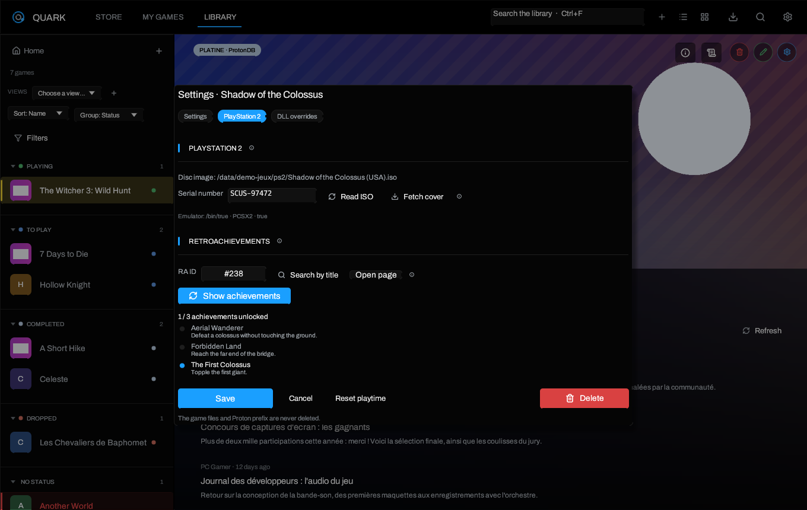

# PlayStation 2 and RetroAchievements

> [Home](Home) · [Getting started](Getting-Started) · **PlayStation 2 and
> RetroAchievements** · [Overlay](Overlay-and-Achievements) ·
> [Troubleshooting](Troubleshooting)



## What the integration does

Quark treats a PlayStation 2 disc image as a normal library entry, but launches
it with **PCSX2** instead of Proton. For a PS2 game:

- no Wine prefix and no Proton runtime are created;
- the serial number is read from the disc when possible;
- the cover is downloaded from the community
  [ps2-covers](https://github.com/xlenore/ps2-covers) repository;
- RetroAchievements progress can be displayed on the game page and in the
  overlay.

PCSX2 remains responsible for emulation, its own settings and RetroAchievements
sign-in and unlocks. Quark is only a launcher and a reader.

## Install PCSX2

Install PCSX2 from your distribution, [pcsx2.net](https://pcsx2.net) or Flathub.
Quark looks for, in order:

1. the path set in **Settings → Stores & tools → PCSX2 binary**;
2. `pcsx2-qt`, `pcsx2`, `PCSX2` or `PCSX2-Qt` in `PATH`;
3. `/usr/bin`, `/usr/local/bin` and the Flatpak exports, including
   `net.pcsx2.PCSX2`.

If the binary is elsewhere, choose it with **Browse…** or type its absolute path.
Leave the field empty to keep following `PATH`.

PCSX2 needs a valid BIOS and its normal memory-card configuration. Quark does
not modify PCSX2 settings, BIOS files or memory cards.

## Add a PS2 game

1. Click **+** in the top bar.
2. Choose **PlayStation 2 game (ISO)…**.
3. Pick an `.iso`, `.chd`, `.cso`, `.bin/.cue` or `.gz` image.
4. Quark creates the game, reads the serial if the image is an uncompressed ISO,
   fetches the cover and selects the new entry.

The image is passed to PCSX2 as its positional argument. Extra arguments typed
in the game page are placed before the image, so PCSX2 options such as
`-fullscreen` work as expected.

The usual **+ → Choose the executable** flow also recognizes a disc image and
turns the entry into a PS2 game. The game's **Game settings → PlayStation 2**
tab can re-read the ISO and fix the serial later.

### Supported formats and serial detection

| Format | Launch | Automatic serial |
| --- | --- | --- |
| `.iso` | Yes | Yes, from `SYSTEM.CNF` |
| `.chd` | Yes | No, enter it by hand |
| `.cso` | Yes | No, enter it by hand |
| `.bin` / `.cue` | Yes | No, enter it by hand |
| `.gz` | Yes | No, enter it by hand |

The serial has four letters, a hyphen and five digits: `SLUS-20062`,
`SCES-51921`, `SLPM-66123`. Quark reads the `BOOT2` line of `SYSTEM.CNF` inside
ISO9660 images, including 2048-byte and raw 2352-byte sectors. A serial entered
without the hyphen is accepted by the cover lookup if it has the right shape.

## Covers

Covers come from
[xlenore/ps2-covers](https://github.com/xlenore/ps2-covers), using the default
2D cover path:

```text
https://raw.githubusercontent.com/xlenore/ps2-covers/main/covers/default/<SERIAL>.jpg
```

The repository also publishes 3D covers at `covers/3d/<SERIAL>.png`, but Quark
uses the default set so the library keeps a consistent look. A missing cover
leaves the monogram; it never blocks the launch. Use **Fetch cover** in the
**PlayStation 2** tab after correcting a serial.

Covers are stored in the normal artwork cache and are not fetched again on every
launch.

## RetroAchievements

### Configure the account

1. Create an account on [retroachievements.org](https://retroachievements.org).
2. Open your profile → **Keys** and copy the **Web API key**.
3. In Quark, open **Settings → Stores & tools → RetroAchievements**.
4. Enter the username and the Web API key.

The key is stored locally in `~/.config/quark/config.json`, like the SteamGridDB
key, and is only sent to `retroachievements.org`. Quark never asks for the
RetroAchievements password.

PCSX2 still needs its own RetroAchievements login in its settings. Quark reads
the same account's progress; it does not sign in for PCSX2 and does not submit
unlocks.

### Link a game

1. Open the PS2 game and its **PlayStation 2** tab.
2. Click **Search by title**. Quark asks the official API for the PlayStation 2
   game list and proposes the closest title.
3. Check the proposed **RA ID** on the RetroAchievements website. Correct it by
   hand if the title match is wrong.
4. Click **Show achievements** to load the progress.

The API has no serial-to-game-ID lookup, which is why the title is used and the
identifier stays editable. Once saved, the RA ID is kept with the game.

### What is displayed

- total and unlocked achievement counts;
- each achievement's name, description and unlock state;
- rarity when the API publishes the number of players and awards;
- the same list in the in-game overlay when the game is launched with an RA ID.

Achievements are read from
`API_GetGameInfoAndUserProgress.php`; no achievement is written back. A missing
or invalid key produces an explicit message instead of an empty list.

## Overlay and launch

When a PS2 game with an RA ID is launched from Quark, the overlay's achievements
panel uses the same RetroAchievements data. The overlay shortcut, screenshot key
and display options are described in
[Overlay and achievements](Overlay-and-Achievements).

Launch options such as GameMode, MangoHud, gamescope, PRIME and a wrapper still
apply around PCSX2. PROTON_LOG and Wine environment variables do not: the
emulator runs natively.

## Troubleshooting

| Problem | Check |
| --- | --- |
| `PCSX2 is not detected` | Install PCSX2, or set its binary in **Settings → Stores & tools**. |
| The game starts but no cover appears | The serial is missing or the cover does not exist in ps2-covers; correct the serial and use **Fetch cover**. |
| The serial cannot be read | Use an uncompressed `.iso`, or enter the serial by hand for `.chd`, `.cso`, `.bin/.cue` and `.gz`. |
| RetroAchievements says the account is not configured | Set both the username and Web API key in **Settings → Stores & tools**. |
| The proposed RA ID is wrong | Open the game page on retroachievements.org and copy its numeric ID. |
| No achievements in the overlay | PCSX2 keeps handling unlocks; Quark only reads progress. Check the RA ID and the account. |
| PCSX2 opens without the game | Check that the image path still exists and that the game page points to the right file. |

See [Troubleshooting](Troubleshooting) for general launch and prefix issues.

---

[Home](Home) · [Getting started](Getting-Started) · [Overlay](Overlay-and-Achievements) · [Troubleshooting](Troubleshooting)
