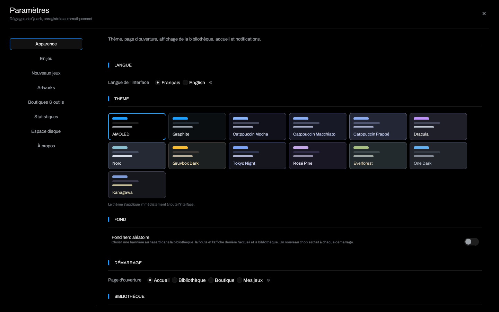

# Réglages

> [Accueil](Home) · [Thèmes et apparence](Themes-and-Appearance) ·
> **Réglages** · [Proton et Wine](Proton-Wine-and-Launch-Options)

Depuis la 1.2, les réglages occupent toute la fenêtre, avec une navigation
latérale et des sections séparées. Chaque modification est enregistrée
automatiquement, sans bouton **Appliquer**.

## Apparence

- **Langue de l'interface** : français ou anglais, appliqué immédiatement.
- **Thème** : 13 palettes, appliquées immédiatement.
- **Fond hero aléatoire** et **Flou** : bannière floutée derrière l'accueil et
  la bibliothèque, tirée une fois par session.
- **Démarrage** : page d'ouverture (Accueil, Bibliothèque, Boutique, Mes jeux).
- **Bibliothèque** : vue liste ou grille.
- **Accueil** : tri du carrousel, défilement automatique et intervalle.
- **Zone de notification** : garder Quark dans l'icône au lieu de quitter.

Détails et captures : [Thèmes et apparence](Themes-and-Appearance).

## En jeu

- **Overlay** : activation, raccourci global et affichage des succès verrouillés,
  compacts, avec progression et rareté.
- **Captures** : touche de capture, notifications.
- **Sauvegardes cloud** : synchronisation Epic/GOG après installation et à la
  fermeture.
- **Overlay Epic (EOS)** : téléchargement et activation de l'overlay EOS dans le
  préfixe du jeu, quand il est disponible.

Les raccourcis par défaut sont `Maj+Retour arrière` pour l'overlay et `F12` pour
les captures. Voir [Overlay et succès](Overlay-and-Achievements).

## Nouveaux jeux

Cette page ne contient **pas** des réglages globaux. Ce sont des valeurs
recopiées dans un jeu au moment de son ajout. Chaque jeu garde ensuite les
siennes ; modifier un défaut ne change aucun jeu existant, et modifier un jeu ne
touche pas les autres.

- **Préfixe Proton** : dossier transmis tel quel. Vide = préfixe automatique
  sous `~/.local/share/quark/prefixes/<jeu>`.
- **Dossier d'installation des boutiques** : parent proposé pour Epic/GOG. Vide
  = `~/Games`.
- **Arguments** : arguments par défaut passés après l'exécutable.
- **Runtime Proton** : runtime préféré ; **Automatique** laisse Quark choisir.
- **Anti-triche** : BattlEye et EasyAntiCheat, deux options indépendantes.
- **Options de lancement** : GameMode, MangoHud, gamescope, PRIME, wrapper,
  PROTON_LOG, umu.
- **Variables d'environnement** : format `NOM=valeur`, recopiées dans chaque
  nouveau jeu.

Les runtimes détectés et leur nombre sont affichés dans cette page, avec
**Redétecter**. Voir [Proton, Wine et options](Proton-Wine-and-Launch-Options)
pour le sens de chaque case et de chaque variable.

## Artworks

- **Sources** : SteamGridDB, Steam, boutique et fichier local.
- **Clé SteamGridDB** : facultative, stockée dans la configuration locale.
- **Téléchargement et remplacement** des couvertures, héros, logos et icônes.
- **Cache** : les images téléchargées sont conservées dans
  `~/.local/share/quark/artwork/`.

La fiche d'un jeu propose aussi **Personnaliser** pour choisir une image
précise, y compris un fichier local.

## Boutiques & outils

- **Synchronisation** : importer ou actualiser la bibliothèque Steam, Epic, GOG.
- **Comptes** : connexion et déconnexion Epic/GOG, clé Steam facultative.
- **Connexions** : état des sessions et actions de synchronisation.
- **Outils gérés par Quark** : Legendary, gogdl, Ludusavi ; installation,
  mise à jour et vérification SHA-256.
- **Overlay Epic (EOS)** : téléchargement et activation.

Voir [Boutiques et sauvegardes](Stores-and-Saves).

## Statistiques

- Temps de jeu total, temps de la semaine et série de jours.
- Barres des douze dernières semaines.
- Carte de chaleur sur 26 semaines.
- Jeux les plus joués.

Les statistiques viennent de l'historique local des sessions. Un temps de jeu
fourni par une boutique peut être affiché sur la fiche, mais l'historique
détaillé reste celui que Quark a observé.

## Espace disque

Mesure en arrière-plan :

- préfixes Proton ;
- cache d'artworks ;
- journaux ;
- archives de mise à jour ;
- dossiers de jeux.

La mesure peut prendre du temps sur une grande bibliothèque. Elle ne supprime
rien et ne propose pas de nettoyage automatique : le bouton dossier ouvre
l'emplacement pour que vous puissiez décider vous-même quoi retirer.

## À propos

- Version installée.
- **Vérifier les mises à jour**, état de la dernière vérification, taille de
  l'archive et installation.
- **Installer les mises à jour au démarrage**.
- **Revoir le guide de démarrage** : rouvre le parcours de bienvenue.
- **Revoir les nouveautés** : rouvre le résumé de la version.
- **Page de la release**, ressources et dossiers de données.

Les mises à jour vérifient la somme SHA-256 et refusent un binaire qui ne
correspond pas au tag attendu. Voir [Installation](Installation).

## Fermer les réglages

Le bouton **×** en haut à droite ferme la page. `Échap` ferme aussi les
panneaux. Les réglages n'interrompent pas un téléchargement, une analyse de
disque ou une synchronisation déjà lancée.

## Voir aussi

- [Thèmes et apparence](Themes-and-Appearance)
- [Proton, Wine et options de lancement](Proton-Wine-and-Launch-Options)
- [Boutiques et sauvegardes](Stores-and-Saves)
- [Dépannage](Troubleshooting)

---

[Accueil](Home) · [Thèmes](Themes-and-Appearance) · [Proton](Proton-Wine-and-Launch-Options) · [Dépannage](Troubleshooting)
