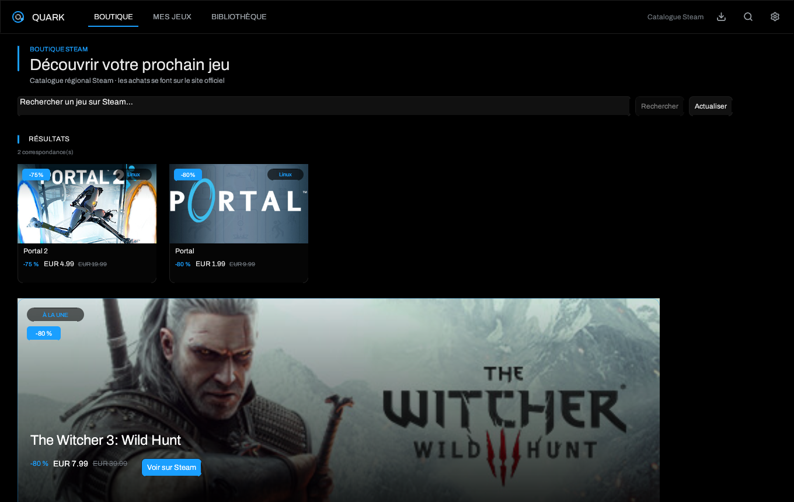

# Boutiques, comptes et sauvegardes

> [Accueil](Home) · [Premier démarrage](Getting-Started) · **Boutiques** ·
> [Bibliothèque](Library-and-Views) · [Dépannage](Troubleshooting)



## Les trois sources

### Steam

Steam est lu **localement**, sans mot de passe Quark :

- `libraryfolders.vdf` indique les bibliothèques ;
- `appmanifest_*.acf` décrit les jeux installés ;
- les dossiers `steamapps/common` fournissent les exécutables.

Une clé Steam Web API et un SteamID64 sont facultatifs. Ils améliorent les
recommandations et l'accès aux métadonnées, mais ne sont pas nécessaires pour
lancer un jeu installé. Steam Cloud reste entièrement géré par le client Steam ;
Quark ne lit ni n'écrit ses sauvegardes cloud.

Routes Steam reconnues : `~/.steam/steam`, `~/.steam/root`,
`~/.local/share/Steam`, le dossier Flatpak
`~/.var/app/com.valvesoftware.Steam/data/Steam` et le dossier Snap.

### Epic Games

Epic utilise **Legendary**, un client open source en ligne de commande.

1. **Paramètres → Boutiques & outils**.
2. Installez ou mettez à jour Legendary avec **Installer / mettre à jour**.
   Quark vérifie la somme SHA-256 publiée avant d'exécuter le binaire.
3. **Connecter Epic** ouvre la page d'autorisation. Copiez le code affiché dans
   Quark.
4. Legendary échange le code localement et écrit `user.json` dans son dossier de
   configuration.

Le mot de passe Epic n'est jamais demandé par Quark et ne transite pas par
l'interface. Pour retirer le compte, utilisez l'action de déconnexion de
Legendary dans **Boutiques & outils** ; le fichier de session est alors supprimé
par l'outil.

### GOG

GOG utilise **gogdl**, également installé et vérifié par Quark. Le jeton GOG est
écrit dans un fichier séparé de `credentials.json`, avec des permissions
privées. Les succès GOG sont lus depuis `gameplay.gog.com` avec cette session.

## Installer un jeu de boutique

**Mes jeux** liste ce que vous possédez ou avez installé, avec un onglet par
boutique. Un jeu non installé ouvre une fiche d'installation ; un jeu installé
ouvre ses actions.

- Le dossier d'installation proposé vient de **Paramètres → Nouveaux jeux →
  Dossier d'installation par défaut**. Il peut être changé pour une
  installation précise.
- Trois téléchargements Epic/GOG peuvent tourner en parallèle. Chacun affiche
  progression, vitesse, temps restant et un bouton **Annuler**.
- L'icône de téléchargement de la barre supérieure liste tous les transferts.
- Une installation annulée ne doit pas être considérée comme complète : vérifiez
  l'état dans **Mes jeux** avant de lancer.

## Sauvegardes cloud Epic et GOG

La synchronisation cloud est activée par défaut dans **Paramètres → En jeu**.
Elle est asynchrone et ne bloque pas l'interface.

### Epic

Quark exécute :

```bash
legendary -y sync-saves <app> --accept-path
```

Legendary compare le dossier local au manifeste cloud ; le côté le plus récent
gagne. Un dossier personnalisé peut être transmis avec `--save-path` depuis la
fiche du jeu.

### GOG

Quark exécute :

```bash
gogdl save-sync <dossier> <game-id> --ts <horodatage>
```

gogdl exige un dossier explicite : choisissez-le dans la fiche du jeu ou dans
**Mes jeux → Dossier de sauvegarde**. L'horodatage renvoyé par gogdl est stocké
dans l'installation et réutilisé à la comparaison suivante.

### Quand la synchronisation a lieu

- après une installation Epic/GOG réussie ;
- après la fermeture d'un jeu lancé par Quark ;
- à la demande, avec **Synchroniser les sauvegardes cloud** dans la fiche.

Quark n'invente jamais une sauvegarde : si aucun côté n'existe, le panneau
l'indique. Une erreur du fournisseur reste visible ; elle n'est pas transformée
en succès.

> La synchronisation cloud est indépendante des instantanés Ludusavi. Les deux
> peuvent être actifs, mais ils ne stockent pas au même endroit.

## Instantanés locaux avec Ludusavi

Ludusavi crée des copies vérifiées des sauvegardes avant et après une session.
Le panneau de sauvegarde est partagé par la bibliothèque et **Mes jeux**.

1. Installez Ludusavi depuis **Boutiques & outils**.
2. Vérifiez ou choisissez le dossier de sauvegarde du jeu.
3. **Aperçu Ludusavi** montre ce qui sera copié.
4. **Sauvegarder maintenant** crée un instantané.
5. **Inventaire** liste les instantanés disponibles ; **Restaurer** vérifie
   puis restaure la version choisie.

La restauration est validée contre les racines d'installation du jeu : les
liens symboliques, `$HOME` comme racine et les chemins hors des racines
autorisées sont refusés. Chaque installation de boutique possède son propre
compartiment Ludusavi, donc deux éditions du même jeu ne se mélangent pas.

Quark ne remplace jamais une configuration Ludusavi illisible : il signale
l'erreur et conserve le fichier.

## Fichiers de compte et de données

| Chemin | Contenu |
| --- | --- |
| `~/.config/quark/credentials.json` | Clé Steam Web API et SteamID64 facultatifs |
| `~/.config/quark/legendary/user.json` | Session Epic écrite par Legendary |
| `~/.local/share/quark/gogdl-auth.json` | Jeton GOG écrit par gogdl |
| `~/.local/share/quark/save-backups/` | Instantanés Ludusavi |
| `~/.local/share/quark/artwork/` | Artworks et icônes de succès en cache |
| `~/.local/share/quark/logs/<jeu>/` | Journaux de session, mode `0600` |

Les écritures de bibliothèque sont atomiques (`fsync` + renommage) et
réessayées en cas d'échec. Un `config.json` corrompu est copié de côté et la
bibliothèque passe en lecture seule plutôt que d'être écrasée par une
bibliothèque vide. Les journaux ne contiennent ni valeurs d'environnement
complètes, ni lignes de commande intégrales, ni le jeton de succès.

## Dépannage rapide

- **Legendary introuvable** : vérifiez `python3`, puis réinstallez l'outil depuis
  les réglages.
- **Connexion Epic expirée** : reconnectez le compte ; le code d'autorisation
  est à usage limité.
- **GOG ne synchronise pas** : un dossier de sauvegarde est obligatoire.
- **La sauvegarde restaurée n'apparaît pas** : vérifiez que le jeu utilise bien
  le préfixe de l'installation active, puis relancez l'aperçu Ludusavi.

Voir [Dépannage](Troubleshooting) pour les erreurs de lancement et de préfixe.

---

[Accueil](Home) · [Proton et Wine](Proton-Wine-and-Launch-Options) · [Overlay](Overlay-and-Achievements) · [Dépannage](Troubleshooting)
