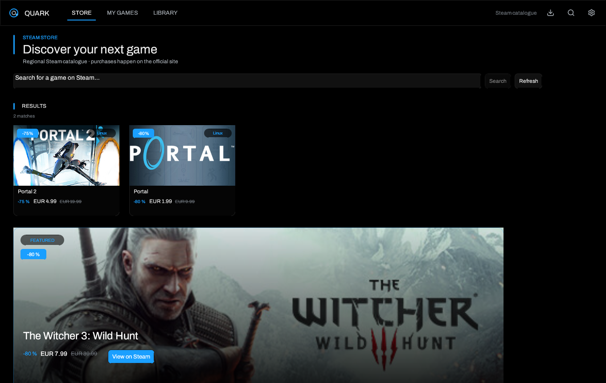

# Stores, accounts and saves

> [Home](Home) · [Getting started](Getting-Started) · **Stores** ·
> [Library](Library-and-Views) · [Troubleshooting](Troubleshooting)



## The three sources

### Steam

Steam is read **locally**, without a Quark password:

- `libraryfolders.vdf` lists the libraries;
- `appmanifest_*.acf` describes installed games;
- `steamapps/common` folders provide executables.

A Steam Web API key and SteamID64 are optional. They improve recommendations and
metadata access but are not needed to launch an installed game. Steam Cloud
remains entirely managed by the Steam client; Quark neither reads nor writes its
cloud saves.

Recognized Steam locations: `~/.steam/steam`, `~/.steam/root`,
`~/.local/share/Steam`, the Flatpak folder
`~/.var/app/com.valvesoftware.Steam/data/Steam` and the Snap folder.

### Epic Games

Epic uses **Legendary**, an open-source command-line client.

1. **Settings → Stores & tools**.
2. Install or update Legendary with **Install / update**. Quark verifies the
   published SHA-256 before running the binary.
3. **Connect Epic** opens the authorization page. Copy the displayed code into
   Quark.
4. Legendary exchanges the code locally and writes `user.json` in its
   configuration folder.

Quark never asks for the Epic password and it never passes through the
interface. To remove the account, use Legendary's logout action in **Stores &
tools**; the session file is then deleted by the tool.

### GOG

GOG uses **gogdl**, also installed and verified by Quark. The GOG token is
written to a file separate from `credentials.json`, with private permissions.
GOG achievements are read from `gameplay.gog.com` with this session.

## Install a store game

**My games** lists what you own or have installed, with one tab per store. A
game that is not installed opens an installation dialog; an installed game
opens its actions.

- The proposed installation folder comes from **Settings → New games → Default
  installation folder**. It can be changed for one installation.
- Up to three Epic/GOG downloads can run at once. Each shows progress, speed,
  time remaining and a **Cancel** button.
- The download icon in the top bar lists every transfer.
- A cancelled installation must not be considered complete: check its state in
  **My games** before launching.

## Epic and GOG cloud saves

Cloud synchronization is enabled by default in **Settings → In game**. It runs
asynchronously and does not block the interface.

### Epic

Quark runs:

```bash
legendary -y sync-saves <app> --accept-path
```

Legendary compares the local folder with the cloud manifest; the most recent
side wins. A custom folder can be passed with `--save-path` from the game page.

### GOG

Quark runs:

```bash
gogdl save-sync <folder> <game-id> --ts <timestamp>
```

gogdl requires an explicit folder: choose it on the game page or in **My games →
Save folder**. The timestamp returned by gogdl is stored with the installation
and reused for the next comparison.

### When synchronization happens

- after a successful Epic/GOG installation;
- after a game launched by Quark closes;
- on demand, with **Synchronize cloud saves** on the game page.

Quark never invents a save: if neither side exists, the panel says so. A
provider error stays visible; it is not turned into a success.

> Cloud synchronization is independent of Ludusavi snapshots. Both can be
> active, but they do not store data in the same place.

## Local snapshots with Ludusavi

Ludusavi creates verified copies of saves before and after a session. The save
panel is shared by the library and **My games**.

1. Install Ludusavi from **Stores & tools**.
2. Check or choose the game's save folder.
3. **Ludusavi preview** shows what will be copied.
4. **Back up now** creates a snapshot.
5. **Inventory** lists available snapshots; **Restore** verifies and restores
   the selected version.

Restoration is checked against the game's installation roots: symbolic links,
`$HOME` as a root and paths outside allowed roots are refused. Each store
installation has its own Ludusavi compartment, so two editions of the same game
do not mix.

Quark never replaces an unreadable Ludusavi configuration: it reports the error
and keeps the file.

## Account and data files

| Path | Content |
| --- | --- |
| `~/.config/quark/credentials.json` | Optional Steam Web API key and SteamID64 |
| `~/.config/quark/legendary/user.json` | Epic session written by Legendary |
| `~/.local/share/quark/gogdl-auth.json` | GOG token written by gogdl |
| `~/.local/share/quark/save-backups/` | Ludusavi snapshots |
| `~/.local/share/quark/artwork/` | Cached artwork and achievement icons |
| `~/.local/share/quark/logs/<game>/` | Session logs, mode `0600` |

Library writes are atomic (`fsync` + rename) and retried on failure. A corrupt
`config.json` is copied aside and the library switches to read-only instead of
being overwritten by an empty library. Logs contain no full environment values,
no complete command lines and no achievement token.

## Quick troubleshooting

- **Legendary not found**: check `python3`, then reinstall the tool from the
  settings.
- **Epic login expired**: connect the account again; the authorization code is
  short-lived.
- **GOG does not synchronize**: a save folder is required.
- **Restored save is not visible**: check that the game uses the active
  installation's prefix, then run the Ludusavi preview again.

See [Troubleshooting](Troubleshooting) for launch and prefix errors.

---

[Home](Home) · [Proton and Wine](Proton-Wine-and-Launch-Options) · [Overlay](Overlay-and-Achievements) · [Troubleshooting](Troubleshooting)
