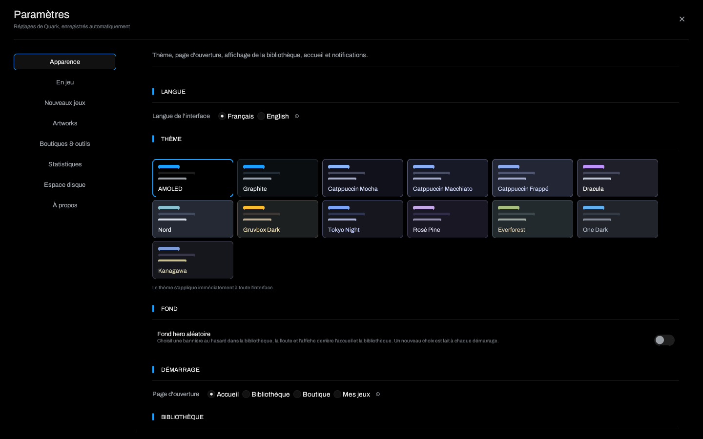
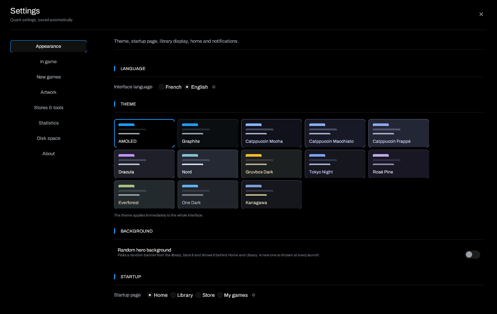

# Themes and appearance

> [Home](Home) · [Getting started](Getting-Started) · **Themes and
> appearance** · [Settings](Settings)

## A full-screen page, not a small dialog

Since 1.2, **Settings** fills the window. A sidebar on the left lists the pages,
the active page is outlined with the accent colour, and each section is
separated by a title and a rule. The **×** button in the top right closes
settings. Content scrolls independently of the navigation.

The pages are: **Appearance**, **In game**, **New games**, **Artwork**,
**Stores & tools**, **Statistics**, **Disk space** and **About**. The
[Settings](Settings) page describes each one.

## Interface language

**Appearance → Interface language** offers **Français** and **English**. The
change is immediate: the whole interface is rebuilt with the new catalogue,
without restarting Quark. The choice is stored in `settings.ui_language`.

This language is **separate** from `settings.language`, which asks the Steam API
for descriptions in a given language. You can keep the interface in French and
Steam pages in English, or the opposite.

Game names, tags and personal genres are not translated: they are your data.
Application labels, tooltips, buttons, statuses and error messages are.

## The thirteen themes

The **Appearance → Theme** grid shows a preview of each palette. One click
applies the theme to the whole interface immediately and saves it.

| Theme | Mood |
| --- | --- |
| **AMOLED** | Pure black, maximum contrast, blue accent. |
| **Graphite** | Neutral grey, softer than pure black. |
| **Catppuccin Mocha** | Warm dark base, pastel accents. |
| **Catppuccin Macchiato** | Slightly lighter Catppuccin variant. |
| **Catppuccin Frappé** | Softer Catppuccin variant. |
| **Dracula** | Dark purple and magenta accents. |
| **Nord** | Cold blue-grey, Arctic inspiration. |
| **Gruvbox Dark** | Warm brown and yellow/green accents. |
| **Tokyo Night** | Night blue and electric purple. |
| **Rosé Pine** | Dark plum and dusty pink. |
| **Everforest** | Forest green and natural tones. |
| **One Dark** | Blue-grey with subdued colourful accents. |
| **Kanagawa** | Deep blue inspired by Japanese prints. |

Each palette defines the background, panels, surfaces, text, borders and an
accent colour with hover and pressed variants. The theme does not change a
game's own accent colour: it is still computed from its artwork.

## Random hero background

**Appearance → Background → Random hero background** adds a blurred banner
behind Home and Library.

- Quark picks a banner from the library artwork.
- The pick is made **once per session**: restarting Quark changes the image,
  switching pages does not.
- The **Blur** slider sets the radius from 2 to 30 px. The blur cache includes
  the radius, so changing it does not reuse the previous render.
- A dark veil is applied between the image and the content to keep text
  readable; the bottom of the page is darker than the top.
- If the library contains no artwork, no background is drawn: the theme keeps
  its normal background.

The background is decorative. It does not replace a game's banner or the library
covers.

## Startup page

**Appearance → Startup → Startup page**:

- **Home** (default);
- **Library**;
- **Store**;
- **My games**.

The choice is read once when the window opens. Changing the setting does not
move you immediately: it applies on the next start. An older configuration
without this field starts on Home.

## Library display

**Appearance → Library** controls:

- the default view, **list** or **grid**;
- the Home sort: last session, date added or playtime;
- automatic carousel advance and its interval;
- the notification icon.

Named views, sorting and grouping are described in
[Library and views](Library-and-Views).

## Notifications and tray icon

The tray icon keeps Quark in the background: the close button hides the window in
the icon instead of quitting. Epic/GOG screenshots can also show a desktop
notification. These settings are in **Appearance** and **In game**.

On some environments without a notification area (some minimal Wayland
compositors), the icon may not appear. Quark remains usable; quit with `Ctrl+Q`.

## Game accent colours

Each game page can derive an accent colour from its artwork. It applies to the
page's buttons and markers without changing the rest of the interface. It does
not change the global theme and is not saved as a separate theme.

## Reset the appearance

To return to the defaults without losing the library:

1. **Settings → Appearance**.
2. Choose **AMOLED**, **Home** and the **List** view.
3. Disable the random hero background.
4. If needed, set the language back to French.

There is no "reset everything" button that erases the library. A full reset would
mean deleting `config.json`, which also deletes games, installations, views and
statistics. Prefer changing settings one at a time.

## See also

- [Settings](Settings) for the other pages.
- [Library and views](Library-and-Views) for named views.
- [Troubleshooting](Troubleshooting) if a text stays in the wrong language.

---

[Home](Home) · [Settings](Settings) · [Library](Library-and-Views) · [Overlay](Overlay-and-Achievements)
